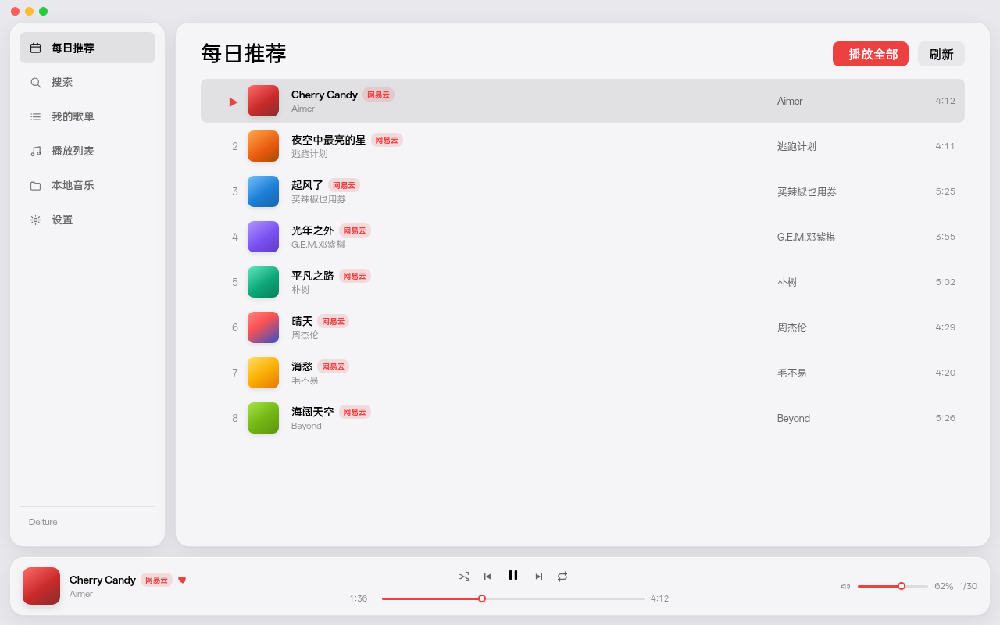
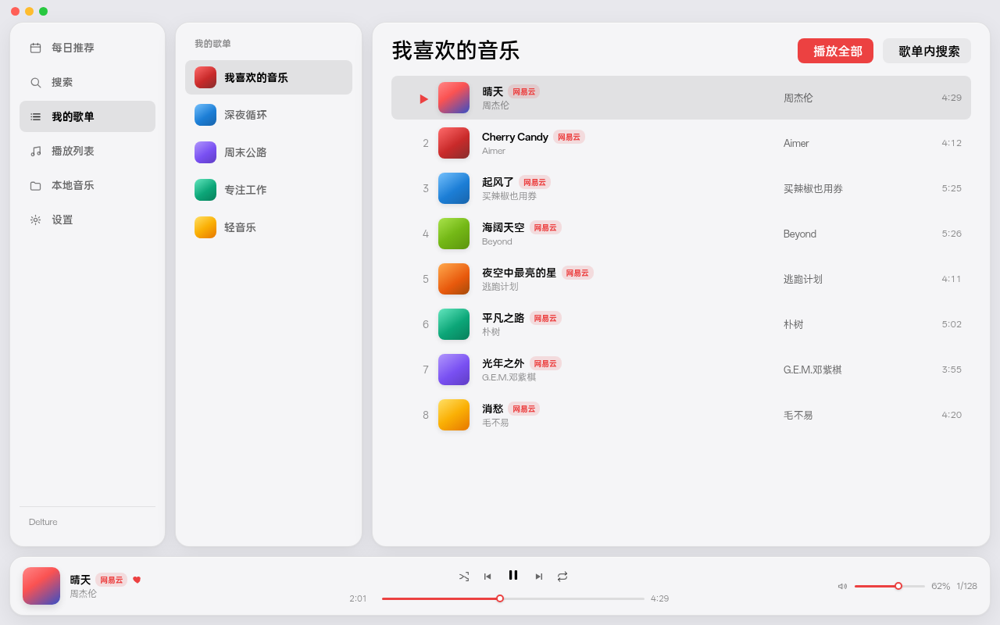
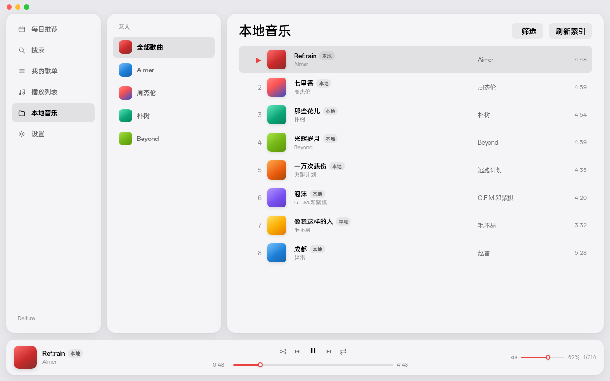
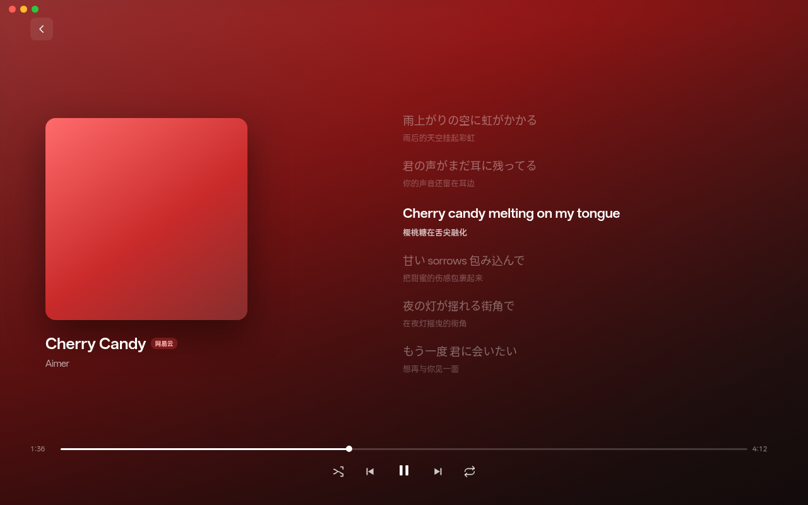

# SlimMusic

轻量音乐播放器：**本地音乐 + 网易云**（每日推荐 / 搜索 / 我的歌单）。  
[Tauri 2](https://tauri.app/) + Rust + Vue 3，支持 **macOS / Windows / Android**。

> 作者：[Yuhua Zhang](https://github.com/Delture)（Delture）

## 预览

浅色主题 · 网易云红强调色（示例界面）：

<p align="center">
  
</p>

| 我的歌单 | 本地音乐 |
|:---:|:---:|
|  |  |

<p align="center">
  
</p>

四块浮动面板（侧栏 / 内容 / 列表 / 底栏）共用同一套背景与描边；播放页支持沉浸式封面背景。

## 功能

| 页面 | 说明 |
|---|---|
| 每日推荐 | 登录后同步当日推荐 |
| 搜索 | 单曲搜索，可加载更多 |
| 我的歌单 | 歌单列 + 曲目列两块浮动面板；支持歌单内搜索；右键可播放全部 / 取消收藏 / 删除 |
| 本地音乐 | 扫描自选文件夹；按专辑 / 艺人 / 文件夹分组；标签、内嵌封面与同名 `.lrc`；拼音筛选 |
| 播放列表 | 本地队列管理（播放全部 / 重命名 / 删除）；可与网易云曲目混排 |
| 播放页 | 点底栏封面进入：大封面 + 滚动歌词（含翻译）；桌面端沉浸标题栏 |
| 设置 | 扫码登录、主题（浅 / 深 / 跟随系统）、强调色（红 / 陶土橙）、音质、本地文件夹、缓存与关于 |

- **红心 / 取消喜欢**，歌单收藏与删除
- **本地 + 网易云混播**：每首歌带来源标记；双击行、点序号 ▶ / 封面，或右键「从这首开始播放」即可把当前列表设为队列
- **启动记忆**：音量、随机、循环与上次队列（保持暂停，不自动续播）
- **缓存**：歌单 / 歌词 / 音频磁盘缓存（LRU）；切歌预取下一首
- **关窗不停播**（桌面）：隐藏到托盘 / 菜单栏；右键可显示、播放控制、退出
- **Android**：后台播放、通知栏与锁屏控制、耳机按键、系统媒体库、手机布局；登录二维码可保存或跳转网易云

本地扫描支持常见有损 / 无损格式（mp3、flac、m4a、aac、wav、ogg、opus、aiff、ape、wma、wv 等）。具体能否播放取决于标签解析与目标平台 WebView / 解码能力。

## 下载

到 [Releases](https://github.com/Delture/slim-music/releases) 下载最新安装包：

| 平台 | 文件 | 备注 |
|---|---|---|
| macOS（Apple Silicon） | `.dmg` | 未签名：首次请右键「打开」，或 `xattr -cr /Applications/SlimMusic.app` |
| Windows（x64） | `-setup.exe` | 若遇 SmartScreen：更多信息 → 仍要运行 |
| Android（arm64） | `.apk` | 允许「安装未知来源应用」 |

应用内可检查更新（设置 → 关于；启动时也会检查一次）。桌面端下载后安装并重启；Android 调起系统安装器。

## 开发

### 环境

**macOS**

```bash
xcode-select --install
curl https://sh.rustup.rs -sSf | sh   # Rust
brew install node                     # Node 20+
```

**Windows**

- [Visual Studio Build Tools](https://visualstudio.microsoft.com/visual-cpp-build-tools/)（勾选「使用 C++ 的桌面开发」）
- [Rust](https://rustup.rs/)（msvc）+ Node 20+
- WebView2（Win10/11 一般已自带）

### 命令

```bash
npm install
npm run tauri dev     # 开发
npm run tauri build   # 打包：macOS .app/.dmg，Windows NSIS
```

Android（需 SDK/NDK，并先 `npx tauri android init`）：

```bash
npx tauri android build --apk
```

其他：`npm run typecheck`；`cd src-tauri && cargo check`；`cargo test -- --ignored`（联网冒烟：匿名搜索 + 二维码 key）。

数据目录 identifier：`dev.slimmusic.app` — `settings.json`、`cookie.txt`（登录态，请按私有文件保管）、`playback.json`、`local_playlists.json`、`cache/`。

界面变量与共享样式见 [设计说明](design/README.md)。

### 结构概览

```
src/                 Vue 3 + TS（无路由 / 无状态库）
  App.vue            侧栏 + 页面注册
  lib/               invoke、播放器、会话、歌词等
  components/        列表、播放条、通用控件
  views/             各导航页与播放页
src-tauri/src/       Rust 命令、网易云、本地扫描、缓存、Android 桥接
```

- 本地曲：`convertFileSrc` → asset 协议 → `<audio>`
- 网易云曲：播放时按音质取直链；无版权 / VIP 不可播则跳过

## 路线图

- [ ] 列表循环空播上限
- [ ] 解灰（可参考 Yokaze unm；GPL-3.0）
- [ ] 浏览并收藏别人的歌单
- [ ] 本地第二轮：文件夹监听、MediaStore 变更、m3u、与网易云匹配

## 字体与许可

界面字体：[OPPO Sans 4.0](https://open.oppomobile.com/new/developmentDoc/info?id=13223)（版权归 OPPO，按官方许可免费嵌入；未改编）。全文见 [`src/assets/fonts/OPPOSans-LICENSE.txt`](src/assets/fonts/OPPOSans-LICENSE.txt)。

代码：**MIT**。依赖 `ncm-api-rs` 0.1.0（WTFPL，SPlayer-Dev，移植自 NeteaseCloudMusicApiEnhanced）。
